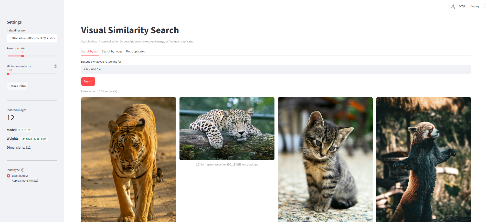

# Visual Similarity Search

[](https://github.com/hinnaparwezuc/Visual-Similarity-Search/actions/workflows/tests.yml)

[](LICENSE)

Search a photo collection by describing what you're looking for in plain
English, or by example image. Powered by [OpenCLIP](https://github.com/mlfoundations/open_clip)
embeddings, [FAISS](https://github.com/facebookresearch/faiss), and an
approximate nearest-neighbour index implemented from scratch.



## Highlights

- **From-scratch HNSW index:** 99.9% recall@10 at 2.4× the speed of exact
  search on 7,390 images, in pure Python ([benchmark results](#results))
- **Zero-shot search quality:** 81% of the top 10 results are the query's
  breed across 37 cat and dog breeds, with no training (random chance: 2.7%)
- **Incremental indexing:** after the first build, only new or changed images
  are re-embedded
- **Near-duplicate detection** for resized copies, re-saved exports and burst
  shots
- **REST API** (FastAPI) with its own search page and interactive docs, plus
  a **Streamlit web app**, for text search, image search and duplicate finding
- **Runs in Docker** with one command: `docker compose up`
- **96 automated tests** run on every push with GitHub Actions, without
  needing PyTorch or model downloads

## Quick Start

Requires Python 3.9 or newer. CUDA is used automatically when available;
otherwise everything runs on CPU.

```bash
git clone https://github.com/hinnaparwezuc/Visual-Similarity-Search.git
cd Visual-Similarity-Search
pip install -r requirements.txt     # ideally inside a virtual environment

# Put some photos in data/images/, then:
python src/indexer.py               # embed and index them (downloads CLIP once)
streamlit run src/app.py            # open the web app
```

Or search from the command line:

```bash
python src/search.py --text "a dog running on the beach" --top-k 5
```

Or run everything in Docker, with no Python setup (see [Docker](#7-run-in-docker)):

```bash
docker compose run --rm api python src/indexer.py --hnsw   # index data/images
docker compose up --build                                  # search page on :8000, app on :8501
```

## How It Works

CLIP maps images and text into the same numerical embedding space, so
semantically related images and text descriptions produce vectors that sit close
together. Searching is then just a nearest-neighbour lookup.

1. `CLIPEmbedder` loads a pretrained OpenCLIP model and generates L2-normalized
   feature vectors for images or text.
2. `indexer.py` embeds every image in a directory and writes a FAISS index plus a
   metadata file mapping index positions back to file paths. The metadata also
   records which model built the index and each file's size and modification
   time, so later runs can update the index incrementally.
3. `search.py` embeds your query with that same model, searches the index by
   inner product (which equals cosine similarity for normalized vectors), and
   returns ranked results.
4. `duplicates.py` compares every indexed image against every other and groups
   the ones above a similarity threshold.
5. `app.py` wraps all of this in a Streamlit interface, and `api.py` exposes
   it as a REST API with a lightweight search page of its own.
6. `hnsw.py` is a from-scratch implementation of Hierarchical Navigable Small
   World graphs, an approximate nearest-neighbour index, and
   `benchmarks/bench.py` measures it against exact search and FAISS's own HNSW.

## Benchmarks

Exact search compares a query against every vector, so its cost grows with the
collection. HNSW builds a layered proximity graph and searches by walking it,
touching only a small fraction of the vectors per query. `src/hnsw.py`
implements it from scratch, following Malkov & Yashunin (2016), including the
diverse-neighbour selection heuristic. Build it with `indexer.py --hnsw` and
search with it using `--backend hnsw` or the app's sidebar.

### Results

Measured on the [Oxford-IIIT Pet dataset](https://www.robots.ox.ac.uk/~vgg/data/pets/):
7,390 photos of 37 cat and dog breeds, embedded with CLIP ViT-B-32 (512
dimensions). 500 queries, k = 10, on a Windows laptop CPU with FAISS limited
to one thread. Raw numbers are in [`benchmarks/results.json`](benchmarks/results.json).

| Index | Recall@10 | Same-breed precision@10 | Median latency | p95 latency | Build time |
| --- | ---: | ---: | ---: | ---: | ---: |
| NumPy, exact | 1.000 | 0.807 | 0.56 ms | 0.82 ms | — |
| FAISS `IndexFlatIP`, exact | 1.000 | 0.807 | 0.89 ms | 1.98 ms | 0.01 s |
| FAISS HNSW, efSearch 16 | 0.991 | 0.808 | 0.03 ms | 0.04 ms | 1.7 s |
| FAISS HNSW, efSearch 64 | 0.999 | 0.807 | 0.08 ms | 0.20 ms | 1.2 s |
| FAISS HNSW, efSearch 256 | 1.000 | 0.807 | 0.30 ms | 0.59 ms | 1.2 s |
| **`hnsw.py`, efSearch 16** | **0.999** | **0.808** | **0.24 ms** | **0.61 ms** | **81 s** |
| `hnsw.py`, efSearch 64 | 1.000 | 0.807 | 0.60 ms | 1.07 ms | 81 s |
| `hnsw.py`, efSearch 256 | 1.000 | 0.807 | 2.63 ms | 5.64 ms | 81 s |

What the numbers show:

- **The from-scratch HNSW beats exact search at this size.** At efSearch 16,
  `hnsw.py` returns 99.9% of the true top 10 while running 2.4× faster than
  exact NumPy search and 3.8× faster than FAISS's exact index, despite being
  pure Python competing with optimized native code.
- **Python costs about 3× at query time and 50–65× at build time.** At matched
  recall (≥ 0.999), FAISS's C++ HNSW answers in 0.08 ms against 0.24 ms for
  `hnsw.py`. Building the graph is where Python hurts most: 81 s versus under
  2 s, because every insertion runs a search through the graph in the
  interpreter.
- **efSearch is the accuracy/speed dial, and 16 is already enough here.**
  Raising it from 16 to 256 makes `hnsw.py` 11× slower for a recall gain of
  less than 0.1%.
- **CLIP finds the right breed without any training.** 81% of each query's 10
  nearest neighbours are the same breed (random chance would be 2.7%), and
  99.4% of queries have at least one same-breed match. Approximate search
  barely affects this: even the fastest setting (FAISS HNSW at efSearch 16)
  misses under 1% of the exact results, and same-breed precision doesn't drop.
- **The graph has the shape the paper predicts.** Its 4 layers hold 7,390,
  474, 31 and 3 nodes. Each of the lower layers keeps about 1/16 of the one
  below, which is 1/M for M = 16, the result of the level-assignment rule the
  paper derives.
- **The graph is cheap to store.** The full `hnsw.py` index is 15.9 MB against
  15.1 MB for the raw vectors alone.

One caveat on the exact baselines: NumPy's matrix multiply can use several CPU
cores through its BLAS library, while FAISS was held to one thread, which is
why exact NumPy edges out exact FAISS here.

### Reproducing the results

```bash
python benchmarks/prepare_pets.py      # downloads ~790 MB, sorts into breed folders
python src/indexer.py --images data/benchmark/images --output data/benchmark/index
python benchmarks/bench.py --index-directory data/benchmark/index --k 10 --queries 500
```

`prepare_pets.py` streams the dataset archive straight into
`data/benchmark/images/<breed>/`, so the archive itself is never saved. Pass
`--per-breed 50` for a smaller, faster run. The folder names give the
benchmark its ground-truth labels.

The benchmark reads the stored embeddings back out of the index, so CLIP does
not run again. It compares four approaches on the same queries: exact search in
NumPy, FAISS `IndexFlatIP` (what this project uses), FAISS `IndexHNSWFlat`, and
`hnsw.py`, sweeping the `efSearch` setting for both HNSW indexes. Each query is
an indexed image, evaluated leave-one-out: the query is removed from its own
results, as `search.py` does. Point it at any index; the default is
`data/index`.

| Column | Meaning |
| --- | --- |
| `build_time_s` | Time to build the index from the embeddings |
| `index_mb` | Serialized size of the finished index |
| `recall_at_k` | Share of the exact top-k the index returned (fidelity to exact search) |
| `label_acc_at_k` | Share of queries with at least one same-folder image in the top-k |
| `label_prec_at_k` | Share of all top-k results from the query's folder (stricter) |
| `p50_ms` / `p95_ms` | Median and 95th-percentile query latency |

The two label columns appear only when images sit in class subfolders.

Options: `--queries` (default 200), `--k` (default 3), `--ef-search` (default
`16 64 256`), `--threads` (FAISS threads, default 1 so all indexes are timed on
one core), and `--out` (default `benchmarks/results.json`).

## Usage in Detail

### 1. Add images

Drop your images into `data/images/`. Subdirectories are searched recursively.
Supported extensions: `.jpg`, `.jpeg`, `.png`, `.webp`, `.bmp`.

### 2. Build the index

```bash
python src/indexer.py
```

After adding, editing or deleting images, update the index instead of
rebuilding it:

```bash
python src/indexer.py --update
```

This embeds only images that are new or have changed (detected by file size
and modification time) and drops deleted ones, so CLIP runs only on what
changed. If nothing changed, the model isn't even loaded.

Options:

| Flag | Default | Description |
| --- | --- | --- |
| `--images` | `data/images` | Directory containing the source images |
| `--output` | `data/index` | Where the index and metadata are written |
| `--batch-size` | `32` | Images processed per batch |
| `--model` | `ViT-B-32` | OpenCLIP model architecture |
| `--pretrained` | `laion2b_s34b_b79k` | OpenCLIP pretrained weights |
| `--update` | off | Only embed new or changed images and drop deleted ones |
| `--hnsw` | off | Also build an HNSW index for approximate search |
| `--hnsw-only` | off | Add an HNSW index to the existing index without re-running CLIP |
| `--hnsw-m` | `16` | HNSW neighbours per node |
| `--hnsw-ef-construction` | `200` | HNSW candidate pool size while building |

This writes `images.faiss` and `metadata.json` into the output directory.
Unreadable or corrupt images are skipped and listed at the end instead of
stopping the build.

With `--hnsw` or `--hnsw-only`, an `hnsw.pkl` graph is saved alongside them.
`--update` keeps an existing graph in sync: new images are added to it, and
since HNSW graphs can't delete nodes, a removal or edit rebuilds the graph from
the stored vectors (without re-running CLIP). A full rebuild without `--hnsw`
removes an old graph, since it would no longer match the images.

`--update` falls back to a full rebuild when there's no previous index, when
the previous index was built with a different model, or when it was built by
an older version of this project that didn't record file details.

### 3. Search from the command line

Search by text description:

```bash
python src/search.py --text "a dog running on the beach" --top-k 5
```

Search by example image:

```bash
python src/search.py --image path/to/query.jpg --top-k 5
```

Options:

| Flag | Default | Description |
| --- | --- | --- |
| `--text` | — | Text description to search for (mutually exclusive with `--image`) |
| `--image` | — | Query image to find visual matches for |
| `--top-k` | `5` | Number of results to return |
| `--index-directory` | `data/index` | Directory holding the index and metadata |
| `--backend` | `flat` | `flat` for exact search, `hnsw` for approximate search |
| `--ef-search` | `64` | HNSW candidates examined per query (higher is more accurate, slower) |
| `--include-self` | off | Keep the query image in results if it is part of the index |

Results are printed as JSON, each entry containing `image_path` and
`similarity_score` (higher is more similar; 1.0 is an exact match). The
index lookup time is printed after the results.

### 4. Find near-duplicates

```bash
python src/duplicates.py --threshold 0.95
```

Groups images that are nearly identical, such as resized copies, re-saved
exports and burst shots. Matches are chained, so if A matches B and B matches
C, all three land in one group. The output lists each group with every image's
similarity to the group's first image, and a summary of how many images could
be removed while keeping one of each. Lower the threshold to find looser
matches; `1.0` finds only identical images.

No CLIP model is needed: the vectors are read back out of the index.

### 5. Use the web app

```bash
streamlit run src/app.py
```

The app has three tabs: search by text, search by uploaded image, and find
duplicates. Results are shown as an image grid. From the sidebar you can set
the number of results and a minimum similarity score, and reload the index
after re-running `indexer.py`. If an HNSW index exists, the sidebar also lets
you switch between exact and approximate search and tune `efSearch`, and each
search shows how long the index lookup took.

### 6. Use the REST API

```bash
uvicorn src.api:app --reload        # or: python src/api.py
```

Open <http://localhost:8000> for a search page built on the API: describe a
photo, upload one, or find duplicates, with results in a grid you can click to
enlarge. Developers can open <http://localhost:8000/docs> for interactive
documentation where every endpoint can be tried in the browser. The API serves
the index in `data/index`; set the `INDEX_DIRECTORY` environment variable to
serve another.

| Method | Endpoint | Purpose |
| --- | --- | --- |
| `GET` | `/health` | Index status: image count, model, whether HNSW is available |
| `POST` | `/search/text` | Search by description |
| `POST` | `/search/image` | Search by uploaded image (multipart form) |
| `GET` | `/images/{image_id}` | Fetch a result image |
| `GET` | `/duplicates?threshold=0.95` | Groups of near-identical images |

```bash
curl -X POST localhost:8000/search/text \
     -H "Content-Type: application/json" \
     -d '{"query": "a dog running on the beach", "top_k": 3, "backend": "hnsw"}'
```

The response looks like this (shortened to one result):

```json
{
  "results": [
    {
      "image_id": 42,
      "image_path": "data/images/beach_dog.jpg",
      "image_url": "/images/42",
      "similarity_score": 0.3121
    }
  ],
  "backend": "hnsw",
  "lookup_ms": 0.21
}
```

Each result's `image_url` points back at the API, which serves images by id
rather than by path, so only indexed files can ever be fetched. Image search
accepts `top_k`, `backend`, `ef_search` and `exclude_exact` (default true,
which hides identical copies of the uploaded image) as form fields. Requests
are validated: bad input gets a `422` describing what's wrong, an unreadable
upload a `400`, and an upload over 20 MB a `413`. If no index exists yet, the
API still starts, and `/health` and searches return `503` with instructions.

### 7. Run in Docker

The repository includes a `Dockerfile` and `docker-compose.yml`. The image
is CPU-only, runs as a non-root user, and has the CLIP weights built in, so
containers start without downloading anything. Your images and index stay on
your machine in `data/`, which is mounted into the containers.

```bash
docker compose run --rm api python src/indexer.py --hnsw   # build the index
docker compose up --build
```

This starts the search page at <http://localhost:8000> (API docs at
<http://localhost:8000/docs>) and the Streamlit app at <http://localhost:8501>. The first build takes a while, mostly downloading
PyTorch and the model. The API container reports healthy once an index is
loaded.

To serve a different index, such as the [benchmark dataset](#reproducing-the-results):

```bash
INDEX_DIRECTORY=/app/data/benchmark/index docker compose up
```

On Windows Command Prompt, run `set INDEX_DIRECTORY=/app/data/benchmark/index`
first, then `docker compose up`. Indexes work in the container as long as
their images are inside the project's `data/` folder.

## Testing

```bash
pip install -r requirements-dev.txt
pytest
```

The tests cover the HNSW index (recall against exact search, saving and
loading, adding in batches), full and incremental indexing, both search
backends, duplicate grouping, every REST API endpoint including validation
and error responses, and the Streamlit app, driven headlessly with
Streamlit's test runner.

They replace CLIP with a lightweight stand-in (`tests/fake_embedder.py`) that
embeds each image from its pixels, so identical images still get identical
vectors and edited copies get similar ones. That keeps the suite fast and means
it runs without PyTorch or downloading model weights. GitHub Actions runs it on
every push.

## Project Structure

```text
Visual-Similarity-Search/
├── .github/workflows/
│   └── tests.yml        # runs the tests on every push
├── benchmarks/
│   ├── bench.py         # compares exact and approximate indexes
│   ├── prepare_pets.py  # downloads the labeled benchmark dataset
│   └── results.json     # latest benchmark results
├── docs/
│   └── screenshot.png   # app screenshot used in this README
├── data/
│   ├── images/          # your source images (contents gitignored)
│   ├── index/           # generated index files (contents gitignored)
│   └── benchmark/       # benchmark dataset and index (gitignored)
├── src/
│   ├── __init__.py
│   ├── api.py           # REST API (FastAPI)
│   ├── static/
│   │   └── index.html   # search page served by the API
│   ├── app.py           # Streamlit web interface
│   ├── duplicates.py    # near-duplicate finder
│   ├── embedder.py      # CLIP embedding engine
│   ├── hnsw.py          # HNSW index written from scratch
│   ├── indexer.py       # builds and updates the index
│   └── search.py        # queries the index
├── tests/
│   ├── conftest.py      # shared fixtures; swaps in the fake embedder
│   ├── fake_embedder.py # pixel-based stand-in for CLIP
│   └── test_*.py
├── Dockerfile
├── docker-compose.yml   # API + web app with one command
├── pytest.ini
├── requirements.txt
├── requirements-dev.txt
├── LICENSE
├── .dockerignore
├── .gitignore
└── README.md
```

## License

[MIT](LICENSE)
